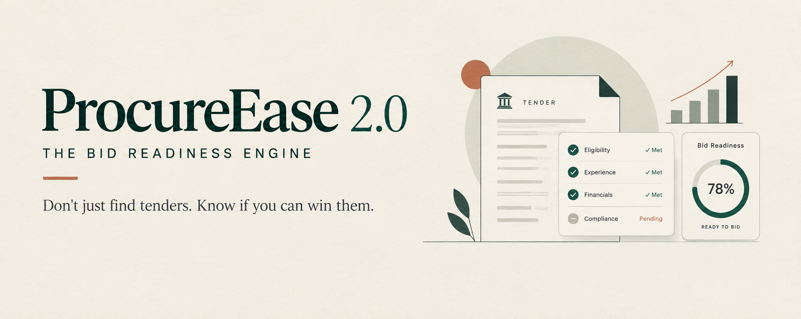

# ProcureEase 2.0
### The Bid Readiness Engine

**Don't just find tenders. Know if you can win them, and exactly what to do next.**

## About the Project

ProcureEase 2.0 is an AI-powered Tender-to-Action Intelligence Platform designed to help startups understand government tender requirements and evaluate their readiness before applying.

The platform aims to simplify the tender application process by identifying eligibility requirements, matching them with company documents, highlighting missing information, and providing actionable guidance.

## The Problem

Government tender applications can be complicated, especially for startups. Understanding eligibility criteria, preparing documents, and identifying missing requirements can be time-consuming and confusing.

## Our Solution

ProcureEase 2.0 aims to make this process easier through intelligent tender analysis and document readiness assessment.

## Key Features

- **Tender Requirement Extraction:** Extract important eligibility requirements from tender documents.
- **Eligibility Matching:** Compare tender requirements with startup information.
- **Document Gap Analysis:** Identify missing or incomplete documents.
- **Bid Readiness Score:** Provide an overview of preparedness for a tender.
- **Actionable Guidance:** Suggest next steps to address identified gaps.
- **Pre-Bid Audit:** Help review readiness before submitting an application.

## How It Works

1. Enter startup information.
2. Upload a government tender PDF.
3. Provide relevant company documents.
4. Analyse tender requirements.
5. Identify matching, partial, and missing requirements.
6. Review the bid readiness assessment and recommended actions.

## Project Vision

To make government procurement more accessible to startups by turning complex tender requirements into clear, actionable steps.

## Technologies Used

*To be updated with the technologies used in the implemented version.*

## Future Scope

- Tender change detection.
- Improved eligibility analysis.
- Expanded document verification.
- Procurement progress tracking.

---

**ProcureEase 2.0 — Tender-to-Action Intelligence.**
